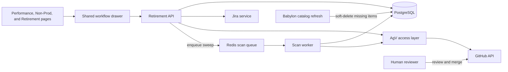

# Retirement System

The retirement system takes a curator's recommendation through owner notification, administrative approval, catalog-change pull requests, and completion. It records the decision and its supporting metrics without deleting the item's analysis history.

[Performance analysis](performance-analysis.md), non-production usage, and content overlap help people decide what to retire. They do not automatically approve a retirement. The workflow, Jira integration, and AgnosticV (AgV) access layer execute that decision. Pull-request review and merging remain human responsibilities.

## Architecture



There is no separate retirement deployment. The API handles individual workflow actions and external-service calls; the scan worker runs scheduled and queued sweeps. The recommendation worker is not involved. Retirement actions use deterministic templates and database operations, not LLM calls.

### Code Organization

| Component | Responsibility |
|---|---|
| `api/routes/analysis.py` | Workflow actions, role enforcement, retirement report, PR-status checks, sweep enqueueing |
| `services/retirement.py` | Workflow status derivation from completed steps |
| `services/retirement_cleanup.py` | Shared required Jira/GitHub cleanup, retries, and per-workflow coordination |
| `services/jira.py` | Ticket creation, notice templates, status lookup, cancellation transition |
| `services/agv_access.py` | Repository/path resolution, GitHub App authentication, branch/file/PR operations |
| `workers/ops.py` | Due-removal creation and merged-PR reconciliation |
| `db/database.py` | Workflow persistence, eligibility queries, soft-delete, and workflow completion |
| `WorkflowDrawer.tsx` | Shared workflow controls, metrics comparison, and Jira/PR links |
| `RetirementPage.tsx` | Retirement report, filters, and access to the shared drawer |

Backend paths above are relative to `src/api/rcars/`; frontend components are under `src/frontend/src/`.

## Workflow and Permissions

Stored steps are ordered as follows:

```text
reviewed → approved → notified → started → retired
```

These are completion markers, not a requirement to perform every step in sequence. Recommendation records both review and approval; notification is optional. The drawer labels the stored `approved` step **Recommend for Retirement** and the `started` step **Retirement In Progress**.

| Action | Required role | Result |
|---|---|---|
| View workflow/report; record review | Curator or admin | Read state or record reviewer/time |
| Recommend retirement | Curator or admin | Record reason, optional replacement, and metrics snapshot |
| Update curator notes | Curator or admin | Save notes independently of workflow progression |
| Record owner notification | Admin | Record notification time and actor |
| Start retirement or link an existing ticket | Admin | Advance an already-recommended item to `started` |
| Open notice/removal PR; refresh external statuses | Admin | Perform GitHub/Jira integration actions |
| Cancel/stop retirement; enqueue sweep | Admin | Attempt cleanup or start a scan-worker job |
| Merge a catalog-change PR | Authorized repository reviewer | Apply the proposed change outside RCARS |

API dependencies enforce these roles. Performance-page visibility does not grant access to retirement controls. The retired step has a timestamp but no separate actor column; automated reconciliation also records audit events.

### Recommendation and Snapshot

A recommendation requires a reason and can include a replacement item. The API captures channel-keyed metrics in `approval_snapshot` so later reporting syncs do not overwrite the evidence behind the decision. For example, using synthetic values:

```json
{
  "snapshot_at": "2026-01-01T00:00:00",
  "sales": {
    "score": 12,
    "provisions": 10,
    "unique_users": 5,
    "experiences": 10,
    "pipeline_touched": 1000,
    "closed_amount": 0,
    "total_cost": 100,
    "page_views": 0
  }
}
```

The drawer compares this snapshot with current metrics. A stored `approved` status is a recommendation, not permission to merge a removal PR.

### Owner Notification

The drawer shows detected maintainers and can generate a copyable notification template. A person sends the message through the appropriate channel; RCARS does not send email or chat messages. An admin records that notification occurred. Starting retirement does not require this marker, so the reviewer must check that any required notice has been given.

### Starting Retirement and Jira

An admin either creates a retirement ticket or links an existing one. Both paths require a prior recommendation and reject an already-started workflow.

Creating a ticket sets `retirement_target_date` from the requested `target_days` (default 30). The API accepts a zero-day request for immediate retirement. Linking a ticket sets the Jira key and started markers but does **not** calculate a target date; without a target date, the automatic removal sweep will not select that workflow.

The Jira service uses direct REST calls with configured credentials. Its wiki-markup ticket description includes the decision, metrics, replacement information, catalog reference, and notice-period length. The notice PR uses a separate AsciiDoc notice helper; Jira does not embed that notice. Resolved Babylon replacements can be linked; other replacements are included as text.

Starting retirement does **not** automatically open the notice PR. An admin uses **Open Notice PR** after starting the workflow. Once retirement is detected, status refresh and the nightly/API sweep close the linked Jira in a terminal state with resolution **Done**, or confirm that it is already closed. Jira work runs outside the API event loop. A failed closure remains tracked and is retried even after catalog retirement; the drawer displays pending cleanup and the last error.

## AgV Access Layer

`services/agv_access.py` is a reusable, async GitHub access layer. Retirement is its current caller. It makes HTTP requests directly rather than cloning a repository or invoking the external retirement shell tooling.

### Repository and Path Resolution

Routing uses the catalog namespace: the two supported Zero Touch namespace prefixes select their respective catalog repositories; other items select the primary AgnosticV repository. All three supported repositories belong to the same organization and use its shared GitHub App installation. `_NAMESPACE_REPO` and `_DEFAULT_REPO` define the concrete mapping in source; no deployment-specific addresses or installation identifiers are needed in this document.

Resolution strips known stage suffixes (`.prod`, `.dev`, `.event`, `.test`) and converts the namespace/item boundary to a directory path. It then lists the repository root and namespace directory to match the actual spelling, ignoring case and hyphen/underscore differences. For example, the synthetic name `example.sample-item.prod` resolves to the logical path `example/sample-item` before spelling verification.

The repository's default branch is discovered from GitHub metadata and used for both the starting commit and PR base. No particular default-branch name is assumed.

### Authentication and Scope

The layer signs a short-lived GitHub App JWT, exchanges it for an installation token, and uses that token for repository operations. Required repository permissions are **Contents: read/write** and **Pull requests: read/write**, with installation access to all supported repositories. RCARS does not merge these PRs.

The supported routing uses `RCARS_GITHUB_APP_INSTALLATION_ID`. Legacy namespace-specific installation settings remain in configuration for compatibility; they are not needed by the current shared-organization mapping.

AgV operations are administrative capabilities. Repository files may contain sensitive configuration: do not expose their contents through public documentation, user-facing chat, screenshots, or troubleshooting output.

### Notice PR

The notice action creates a branch, prepends the shared AsciiDoc retirement notice to `description.adoc`, and opens a PR. It stores the result in `agv_notice_pr_url`. A missing description file is reported as an error rather than silently creating an unrelated file.

The notice includes the target date, replacement information when available, and the contact text from the shared template. The source template is authoritative; public examples must not copy personal contact details or live catalog links from generated notices.

### Removal PR

The removal action builds a deletion commit for the resolved CI directory using the Git Trees API. It is not limited to deleting the production-stage YAML file. An admin may open it before the target date once the workflow is started and has a linked Jira ticket. The automatic sweep, described below, waits for the target date.

!!! warning "Review the removal scope"
    Check the resolved repository and directory, all affected stages, replacement content, and notice requirements before merging. RCARS opens a proposal; it does not approve the removal or directly destroy running environments.

### Retries and Existing PRs

Stored notice/removal URLs are returned without creating another PR. The helpers also reuse an existing open PR when branch creation reports a conflict, read the existing branch on retry where needed, and recover an existing PR after a duplicate-creation response. Branch names combine the item, ticket key, date, and action suffix where applicable.

These checks do not form a distributed transaction across GitHub and PostgreSQL. A failure can leave an external branch or PR before its URL is saved. Inspect external state before retrying or clearing stored links; do not assume any arbitrary failure is safe to repeat.

## Sweeps and Status Reconciliation

### Automatic Removal Eligibility

The scan worker opens a removal PR when a workflow:

- Has a started marker and a linked Jira key.
- Has a non-null target date on or before the database's current date.
- Has no stored removal PR, cancellation request, pending revert PR, or retired marker.

The eligibility query does not require a merged notice PR. Human review is still responsible for notice policy. Per-item failures are logged so other items can proceed.

### Checking Merges

The API/nightly sweep also checks outstanding removal and cancellation-revert PRs, even when no new removal PRs are due. A merged removal PR sets `step_retired_at` and workflow status `retired`, preserving an existing completion timestamp. An open PR, a closed-but-unmerged PR, or a failed status lookup does not complete retirement.

Admins can obtain the same live statuses through `check-prs`. The drawer attempts this check on open and provides a manual refresh action. Notice and removal links show merged/closed status with strikethrough. There is no required GitHub webhook and no continuous browser polling loop.

When a cancellation-revert PR has merged, reconciliation removes the workflow only after required Jira closure and the remaining GitHub cleanup succeed. Cancellation takes precedence over removal completion. Failed cleanup is retained, surfaced in the drawer/job errors, and retried; it is not treated as a successful cancellation.

### Execution Paths

| Entry point | Behavior |
|---|---|
| Nightly maintenance | Runs the retirement sweep after the Babylon and portfolio-architecture sub-pipelines when a GitHub App ID or Jira API token is configured |
| **Run Retirement Sweep** on Sync & Analysis | Enqueues the full sweep on `arq:queue:scan` |
| Retirement sweep API action | Returns a job ID; the scan worker creates due PRs and reconciles merges |
| `rcars retirement sweep` | Direct CLI path that opens due removal PRs; currently does not perform merged-removal/revert reconciliation |
| Drawer refresh / `check-prs` | Synchronous status check for one workflow, with workflow completion or cancellation cleanup |

Queued sweep jobs publish progress through Redis/SSE and persist a result containing `processed`, `prs_opened`, `retirements_completed`, `reverts_completed`, and per-item `errors`. `processed` counts workflows selected for new removal creation, not every PR checked. A completed job can still contain item-level errors; inspect the result and logs.

Each sweep operation checks the credentials it needs. Removal PR creation and PR lookups require the GitHub App ID, private key, and installation ID. Jira closure requires the Jira API email and token, but only when an issue is linked and no closure marker has been recorded. GitHub-only configurations can still open removal PRs and finish workflows with no remaining Jira work; Jira-only configurations can close issues for already-recorded retirements without a GitHub lookup. Missing credentials retain the workflow with a targeted pending-cleanup error rather than calling the unavailable integration. Cancellation still completes its required GitHub work before Jira closure.

## Cancellation and Recovery

Cancellation is an admin action:

1. Attempt to close an open removal PR. A merged removal is not undone by this action.
2. Check the notice PR: attempt to close it if open, or create a notice-removal PR if it was merged.
3. Close the linked Jira issue in a terminal state with resolution **Won't Do**, or confirm that it is already closed. Missing closing transitions and external failures block cancellation completion.
4. Keep the workflow while a notice revert awaits merge or any cleanup remains incomplete. Delete it only after both Jira and GitHub cleanup succeed. Workflows without a linked Jira need only GitHub cleanup.

`pending_revert` is an action response, not another stored workflow status. A durable cancellation-request marker is set before external work, even when no revert PR is needed. It prevents new automatic removal PRs and lets refresh/nightly sweeps resume failed cleanup. The stored revert URL tracks a required notice-revert merge. A closed-but-unmerged revert requires manual recovery and does not finish cancellation.

Deleting a workflow also removes that row's snapshot and workflow notes. The separate action log remains; cancellation is not a versioned archive of the deleted workflow.

GitHub and Jira cleanup is not atomic. RCARS closes an open removal PR before creating a notice revert. Any required cleanup failure returns an error and retains the workflow and links for retry; earlier successful external changes are not rolled back. Already-closed Jira issues retain their existing resolution. Per-workflow locks coordinate API cleanup with sweep actions, and update-only tracking prevents a late response from recreating a deleted workflow.

Restoring an already-removed CI requires a separate repository change and catalog publication. Cancellation does not restore deleted configuration or automatically reopen Jira.

If successful repository listings confirm that the CI directory or notice is already absent, notice cleanup is complete without creating a revert. Lookup and authentication failures are not treated as proof of absence; tracking remains until they can be resolved.

## Catalog Soft-Delete

Workflow completion and catalog visibility are separate:

- `retirement_workflow.step_retired_at` records that the retirement workflow completed, including detection of a merged removal PR.
- `content_entities.retired_at` records that a content entity disappeared from its source catalog. Completing a workflow from a PR check does not set this field.

During a successful Babylon refresh, missing items are soft-deleted with a retirement reason, while their analysis, embeddings, workload mappings, and notes remain available. An empty catalog scan is guarded against mass retirement. When no active stage siblings remain, catalog retirement can also complete associated workflows, even without an RCARS-created removal PR.

Active catalog queries normally exclude soft-deleted items. Curators can include them through the Browse **Show Retired** control; item detail and retirement reporting remain available. If an item reappears in a later scan, RCARS clears its catalog retirement markers. That does not automatically erase an existing workflow's completion history.

Reporting metrics are refreshable data, not an immutable archive. Fully retired base names are excluded from normal reporting imports; cleanup may remove derived performance rows. The approval snapshot is the durable record of the metrics used for the decision. Partial retirement can leave active stage variants in performance/non-production views.

## Retirement Report

The curator/admin report at `/analysis/retirement` includes recommended workflows and soft-deleted items, including retirements initiated outside RCARS. The API deduplicates stage variants by base name, preferring a workflow-bearing row, then usage.

It exposes three effective statuses: **Recommended** (`approved`/`notified`), **In Progress** (`started`), and **Retired** (workflow completion or catalog soft-delete). A review-only record is not enough to enter the report. The report supports 6- and 12-month metric windows, searches by display name, and falls back to non-production usage when performance metrics are unavailable. Status/namespace filters and sorting are applied by the frontend. Each row can open the shared workflow drawer.

## Data and Audit Trail

Workflows are keyed by `content_id`, referencing `content_entities`. APIs accept a base name and resolve a representative stage-specific entity, including retired entities; the database key is not the unqualified base name.

| Fields | Purpose |
|---|---|
| `status`, `step_*_at`, `step_*_by` | Stored stage, completion markers, and actors where present |
| `approval_reason`, `approval_snapshot` | Decision rationale and channel-keyed evidence |
| `replacement_ci`, `replacement_name` | Suggested successor |
| `jira_key`, `jira_project`, `retirement_target_date` | Ticket linkage and automatic-sweep timing |
| `agv_notice_pr_url`, `agv_retire_pr_url`, `agv_revert_pr_url` | External PR references, not cached merge-state columns |
| `cancellation_requested_at`, `jira_closed_at`, `cleanup_error` | Durable cancellation intent, confirmed Jira closure, and retryable cleanup failure |
| `curator_notes`, `created_at`, `updated_at` | Notes and record history timestamps |

Actions such as `retirement_reviewed`, `retirement_approved`, `retirement_notified`, `retirement_started`, `retirement_jira_linked`, `agv_notice_pr_opened`, `agv_retire_pr_opened`, `retirement_cancel_pending`, `retirement_cancelled`, and `retirement_completed` are recorded in `analysis_log`. Worker/catalog lifecycle events also appear in structured logs. These can contain user identities and external references; treat them as operational data, not documentation examples.

The schema source of truth is `SCHEMA_SQL` in `db/database.py`. Deploy-time `rcars init-db` adds the PR-link and cleanup-tracking columns idempotently and marks existing revert-linked workflows as cancellations; no destructive reset is required. Existing retired workflows with linked Jira issues and no closure marker will be checked on subsequent sweeps, so review those issues before enabling the new behavior. See [Data Design](data-design.md).

## Programmatic Access

Open **Swagger UI at `/api/v1/docs` on your RCARS deployment** and select **Retirement** for the endpoint contracts, request and response schemas, and access requirements. See [API Reference](api-reference.md#interactive-api-documentation) for documentation interfaces and authentication guidance.

The lifecycle and permissions above apply equally to the UI and programmatic clients. Retirement operations are grouped separately from performance scoring and muting; the former performance-workflow routes were replaced, not retained as aliases.

## Configuration and Operations

| Variable | Purpose |
|---|---|
| `RCARS_GITHUB_APP_ID` | GitHub App identifier; also gates the nightly retirement step |
| `RCARS_GITHUB_APP_PRIVATE_KEY` | PEM signing key, supplied through a Secret |
| `RCARS_GITHUB_APP_INSTALLATION_ID` | Shared organization installation with access to supported repositories |
| `RCARS_JIRA_BASE_URL` | Jira service address |
| `RCARS_JIRA_API_EMAIL`, `RCARS_JIRA_API_TOKEN` | Jira service-account credentials |
| `RCARS_PIPELINE_ENABLED`, `RCARS_PIPELINE_HOUR`, `RCARS_PIPELINE_MINUTE` | Nightly scheduling; see [Operations](../admin/operations.md#changing-the-schedule) |

Supply GitHub App settings to **both the API and scan-worker deployments**: individual actions run on the API, while automatic and queued sweeps run on the scan worker. A successful interactive PR action does not prove that the worker has credentials. The direct CLI path needs its own configured environment. Keep environment-specific values in the approved secret store and gitignored deployment vars, not shared examples.

!!! warning "Before enabling automation"
    Review existing started workflows and overdue target dates first. Enabling the GitHub App for the nightly pipeline can open removal PRs for previously created workflows on its first run. Schema migration alone does not start the sweep.

When troubleshooting, check the saved workflow, external PR state, job result, and restricted structured logs. Typical causes include missing worker credentials, insufficient installation access, unresolved directories, missing descriptions, missing target dates, closed-unmerged PRs, and pending cancellation reverts. Do not clear workflow links or force a removal just to make a status display change.

### Publication Safety

Public documentation describes configuration names, logical relationships, and API paths only. Use synthetic values for examples. Never publish live App/installation IDs, ticket or PR identifiers, tokens, private-key material, personal contact details, secret-manager entry names, cluster addresses, internal service URLs, or authenticated request/log output. Historical plans under `docs/superpowers/`, local security audit reports, and the local migration runbook are explicitly excluded from the documentation site, including its search index.
