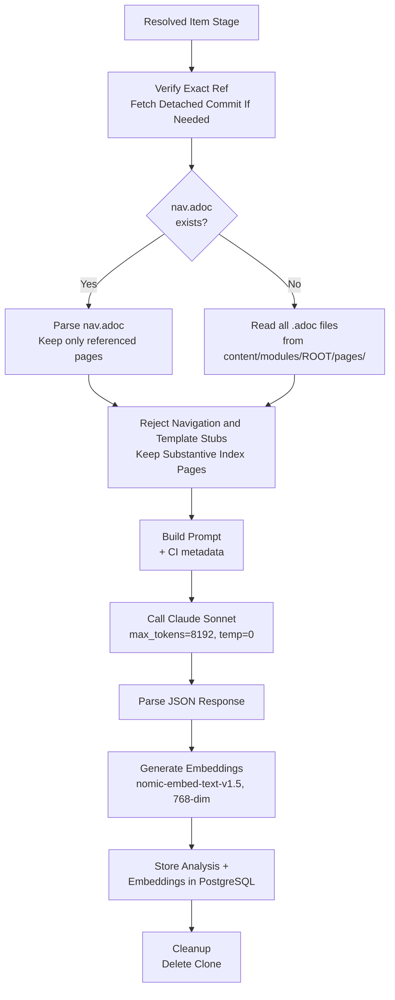

# Scan Pipeline

The scan pipeline is how RCARS understands what each lab teaches. For every catalog item that has a Showroom (a Git repository containing the lab's AsciiDoc content), the pipeline clones the repo, reads the content files, sends them to an LLM for structured analysis, generates vector embeddings from the analysis, and stores everything in PostgreSQL. The result is a searchable understanding of each lab — its topics, learning objectives, audience, duration, and format suitability — that powers both the recommendation engine and content overlap detection.

The worker and CLI use `services/showroom_scan.py` for atomic, target-only persistence, `showroom_source.py` for explicit content ownership, and `analyzer.py` for verified analysis and incremental embedding repair. It can be triggered per-item, in bulk for items needing work, or automatically during nightly maintenance.



Each item is processed independently with no shared state between items.

## Step 1 — Clone

Resolve the requested branch, tag (including annotated tags), full commit ID, or default HEAD. Ambiguous short branch/tag names require qualification. Fetch the exact detached commit with depth 1 and verify it before reading content. A missing ref fails with `invalid_ref`; there is no default-branch fallback. Unchanged verified sources do not clone.

## Step 2 — Read

AsciiDoc files are read from the standard Antora content layout: `content/modules/ROOT/pages/*.adoc`. If a `nav.adoc` navigation file exists, RCARS parses it to identify which pages are actively linked — only pages referenced in `nav.adoc` xref lines are included. This prevents reading orphaned or draft pages that are present in the repo but not part of the live content. A custom content path can be set via the `content_path` field to handle non-standard repository layouts. Files are read with error-replacement for encoding issues. The repository HEAD commit SHA and timestamp are recorded for staleness tracking.

## Step 3 — Filter Boilerplate

Navigation, credentials boilerplate, and known Publishing House placeholder pages are filtered before donor lookup or LLM calls. Substantive `index.adoc` pages and valid short overviews remain analyzable. If filtering removes everything, the scan reports `no_content`; it never falls back to the rejected text. Scans and freshness checks use the same contained content path, rejecting traversal and escaping symlinks.

This filtering step is important for analysis quality. Without it, the LLM would spend a significant portion of its context window on content that looks similar across every Showroom in the catalog and teaches it nothing about what makes this particular lab unique.

## Step 4 — Build Prompt and Call Sonnet

The filtered file contents are concatenated with file-level headers and truncated to a maximum of 150,000 characters. This text, along with the catalog item's metadata (CI name, display name, category, product), is inserted into the analysis prompt template (`prompts/analyze_showroom.txt`).

The prompt instructs the model to focus on what someone would **learn or experience** by completing the lab. It explicitly tells the model to skip boilerplate pages (login, credentials, environment setup) even if they slipped through the file-level filter. The prompt asks for structured JSON covering:

- **Content type** — `workshop` or `demo`
- **Summary** — 2-3 sentence description of what the lab covers and who it's for
- **Products** — Red Hat product names covered (official names)
- **Audience** — target audience descriptors (e.g., "platform engineers", "developers")
- **Difficulty** — `beginner`, `intermediate`, or `advanced` based on prerequisite knowledge
- **Estimated duration** — realistic completion time in minutes
- **Topics** — specific technical topics (e.g., "Kubernetes operators", "CI/CD pipelines")
- **Learning objectives** — split into two categories:
    - **Stated**: objectives the Showroom explicitly claims
    - **Inferred**: objectives determined from the actual exercises (e.g., a lab that deploys with ArgoCD teaches "GitOps workflows" even if never stated)
- **Modules** — per-module breakdown with title, topics, learning objectives, and duration estimate
- **Use cases** — business problems this content helps solve
- **Event fit** — suitability assessment for two formats: `demo` and `hands_on_lab`, each with a boolean and notes explaining why

Temperature is set to 0. Each analysis call is completely stateless — no conversation history is maintained between items, and the model has no knowledge of other items in the catalog.

### Example Output

A typical analysis response (abbreviated) looks like:

```json
{
  "content_type": "workshop",
  "summary": "A hands-on workshop that guides platform engineers through deploying and configuring Red Hat OpenShift AI on an existing OpenShift cluster, including model serving, data science pipelines, and GPU workload management.",
  "products": ["Red Hat OpenShift AI", "Red Hat OpenShift Container Platform"],
  "audience": ["platform engineers", "ML engineers", "data scientists"],
  "difficulty": "intermediate",
  "estimated_duration_min": 120,
  "topics": ["model serving", "data science pipelines", "GPU scheduling", "S3 storage integration"],
  "learning_objectives": {
    "stated": ["Deploy and configure OpenShift AI components", "Create and manage data science projects"],
    "inferred": ["Kubernetes resource management for ML workloads", "Object storage integration patterns"]
  },
  "modules": [
    {
      "title": "Deploying OpenShift AI Operator",
      "topics": ["operator installation", "custom resource configuration"],
      "learning_objectives": ["Install and configure the RHOAI operator"],
      "estimated_duration_min": 20
    }
  ],
  "use_cases": ["AI/ML platform enablement", "self-service data science environments"],
  "event_fit": {
    "demo": {"suitable": true, "notes": "First two modules work well as a 30-min demo of RHOAI capabilities"},
    "hands_on_lab": {"suitable": true, "notes": "Full workshop designed for 2-hour hands-on session"}
  }
}
```

This structured output drives everything downstream: the summary and learning objectives feed into vector embeddings for semantic search, the module breakdown enables the recommendation engine to suggest partial lab usage, and the duration estimate informs duration-aware reranking.

## Step 5 — Parse Response

Sonnet's response is expected to be JSON. The parser handles common response artifacts: markdown code fences (`` ```json ``), leading/trailing whitespace, and partial JSON embedded in a longer response. If parsing fails entirely, the item is marked as an error.

## Step 6 — Generate Embeddings

This is where the structured analysis from Step 4 gets converted into a form that enables semantic search. The analysis JSON tells us *what* a lab teaches in human-readable terms. The embedding step converts that into a **vector** — a list of 768 numbers — that captures the *meaning* of that content in a way that a database can search efficiently.

The conversion is done by the nomic-embed-text-v1.5 model served by a dedicated vLLM server (configured via `RCARS_EMBEDDING_URL`). The model takes text as input and produces a 768-dimensional vector as output. Texts with similar meaning produce similar vectors — so two labs that both teach "deploying applications with GitOps on OpenShift" will have vectors that point in roughly the same direction, even if one uses ArgoCD terminology and the other uses Flux.

These vectors are stored in the `embeddings` table in PostgreSQL (using the pgvector extension) and are the foundation for two features:

- The [recommendation engine](recommendation-engine.md) converts a user's query into the same kind of vector and finds the closest lab vectors — this is how RCARS matches "I need content about Kubernetes security" to labs that cover ACS, compliance operators, and pod security standards.
- [Content overlap detection](content-overlap.md) compares lab vectors against each other to find duplicates — two labs with very similar vectors teach substantially the same material.

### What Goes Into Each Embedding

RCARS generates two types of embeddings per catalog item:

**CI-level embedding** (one per item) — the primary search target. Built by concatenating:

- Analysis summary
- All learning objectives (stated + inferred)
- Topics
- Products
- Audience descriptors
- Use cases
- **Catalog keywords** from the CRD's `spec.keywords` (event tags like `rh1-2026`, product identifiers, lab codes)

The catalog keywords are important because they contain metadata not present in the Showroom content itself. Including them means queries like "Summit 2026 labs" can match via vector similarity even when the Showroom content never mentions the event.

**Module-level embeddings** (one per module) — built from each module's title, topics, and learning objectives. Stored for future module-level matching but not currently used in search.

### Keyword Sourcing

The CI-level embedding combines data from **two different sources**: keywords come from Kubernetes CRDs (read during catalog refresh), while the analysis comes from the LLM (generated during scanning). The embedding is built at scan time by combining both. If keywords are added or changed in the CRD after the last scan, the embedding will not reflect them until the item is re-scanned.

### Technical Details

The embedding model runs on a dedicated vLLM server that provides an OpenAI-compatible `/v1/embeddings` API. Nomic requires task prefixes (`search_document` for indexing, `search_query` for queries), which RCARS applies automatically. Embeddings are normalized to unit vectors, which makes cosine similarity equivalent to dot product. pgvector's IVFFlat index on the embedding column enables fast nearest-neighbor search across thousands of vectors.

## Step 7 — Store and Clean Up

Analysis, provenance, card, and embeddings commit together after locking and rechecking the target's source configuration. Results whose configuration changed return `superseded`, not success. No lock is held during Git/LLM calls. The temporary clone is always deleted in a `finally` block. Unchanged paths do not replace generated artifacts.

---

## Scoped Reuse and Incremental Maintenance

Each eligible item stage gets its own job only when it needs work, including
virtual items. Shared URLs, refs, SHAs, hashes, lab numbers, and infrastructure
bases never establish item identity. There is no unsolicited sibling fan-out.

The stage-specific CRD graph resolves to its nearest explicit content owner,
including components without CatalogItems and multi-hop transparent wrappers.
Nearer repo/ref/path overrides establish their own scope. Ambiguous, missing,
cyclic, unresolved, and excessive-depth graphs fail visibly; no source anywhere
is an ordinary no-Showroom outcome. Infrastructure inheritance stays separate.

Reuse requires the same authorized item/content-owner scope and complete matching
versioned signatures: repo, exact requested ref, selected path, fetched commit,
content hash, actual prompt/vocabulary/model inputs, and policy version. Legacy,
stale, failed, retired, or incomplete donors cannot donate. Each target owns its
materialized analysis/card/embeddings and durable donor provenance. Summary text
uses that target's display name and keywords. Recommendation promotion follows
verified exact stage counterparts or explicit content-delegation paths only.

- Same source/revision/context with current complete embeddings: lightweight
  freshness check only; no analysis job, clone, LLM, embedding call, or replacement.
- New commit with identical selected content/context: fetch once and advance the
  verified revision while preserving `generated_commit` and `last_analyzed`.
- Changed content/context: analyze or use a fully matching authorized donor.
- Changed/missing embedding artifacts: repair only affected vectors, without
  rerunning otherwise-current LLM analysis.
- Explicit force/rescan-all bypasses unchanged and donor fast paths for targets.

Historical/curated data is preserved during the separately approved,
[dry-run-first Babylon artifact rebuild](../operations/showroom-analysis-rebuild.md).

---

## Error Classification

When a scan fails, RCARS records its class on `content_entities.scan_error_class`.
Resolution failures include `invalid_source` and `ambiguous_source`; exact Git
ref failures use `invalid_ref`. Other categories include:

| Error Class | Cause |
|---|---|
| `jinja_url` | Showroom URL contains unresolved Jinja2 template variables |
| `timeout` | Git clone or LLM call exceeded timeout |
| `private_repo` | Git repository requires authentication |
| `http_404` | Repository URL returns 404 |
| `clone_failed` | Git clone failed (network, permissions, other git error) |
| `missing_antora` | Repository does not follow standard Antora layout (`content/modules/ROOT/pages/`) |
| `no_content` | No substantive content files found after boilerplate filtering |
| `parse_error` | LLM response could not be parsed as JSON |
| `unknown` | Unclassified error |

Error classes enable targeted debugging — `jinja_url` errors indicate a catalog metadata issue, while `no_content` errors may need a custom `content_path` override.

---

## Infrastructure Scanning

Alongside the Showroom content pipeline described above, RCARS also scans the AgnosticD v2 automation repos to build an **infrastructure catalog** of workload roles and base configs. This runs as part of the nightly pipeline (Step 4).

The infrastructure scanner clones the agDv2 collection repos, reads key Ansible files (defaults, tasks, templates) from each role or config directory, and sends them to the LLM for structured analysis. The LLM determines what each role installs, its products, capabilities, category, and prerequisites. Results are stored in the `infrastructure` table with vector embeddings that power semantic search through the Advisor chat.

Change detection works via `git ls-remote` — repos whose HEAD SHA matches the last scan are skipped entirely. Config scanning follows the same pattern for base config directories.

For full details, see [Infrastructure Catalog](infrastructure-catalog.md).

---

## Configuration

| Variable | Default | Purpose |
|---|---|---|
| `RCARS_MODEL` | `claude-sonnet-4-6` | Model used for content analysis |
| `RCARS_MAX_PARALLEL` | 5 | Max concurrent scan jobs per worker pod |
| `RCARS_CLONE_DIR` | `/tmp/rcars-clones` | Temporary directory for git clones |
| `RCARS_STALE_DAYS` | 3 | Days before content is considered potentially stale |

## CLI

```bash
rcars refresh              # Sync catalog from Babylon CRDs
rcars scan [--max N]       # Process eligible stages needing analysis/embedding repair
rcars scan --content-id babylon:example.content.prod  # Limit to selected targets
rcars scan --force         # Explicit fresh analysis; bypass skip/reuse
rcars status [--failures]  # Show catalog and analysis status
```

## API

See [Swagger UI](api-reference.md#interactive-api-documentation) under **Content Analysis** and **Catalog** for scan, stale-check, rescan, single-item analysis, and catalog-refresh contracts. Long-running operations return a job ID for progress tracking.
